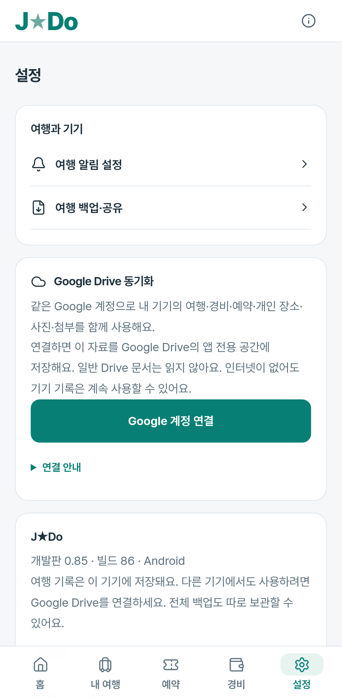

# 0.85 가이드 흔적 정리 확인

[정리한 항목·보존 범위](../../../POST-GUIDE-CLEANUP.md), [빌드·공개 배포 확인](../../release-0.85-verification.json).

홈·내 여행·예약·경비·설정 및 여행 준비의 요약·예약·준비물·자료를 실제 브라우저에서 열어 확인했다. 아래는 개인 자료가 아닌 합성여행을 사용한 모바일 설정 화면이다. 사진 출처 메뉴를 제거하고 알림·백업·Drive·앱 정보·이용/개인정보 안내를 유지했다.

관련 PC·모바일158개가 통과했다. 새 확인10개와 기존 사진·일정/항공/호텔·저장 실패/복구·Drive·Google경로 검사를 실행했다. 재무/알림의 변경 없는 모든 과거 검사를 이번 통과 수로 계산하지 않는다. 초기 새 확인10개 중8개 통과·2개는 준비 관리의 실제 button을 tab으로 찾던 검사 오류로 실패했으며 올바른 접근성 역할로 수정했다. 이후158개 검사가 모두 통과했다.

사용자 앱의 가이드사진/조사자산 제외와 관리자 보관 출력의 분리, 구버전 사진 출처 창의 안전한 복귀, 가이드 사진 요청0건, 기존개인 도시·장소 사진의 표시·메모/예약/ID 보존·전체ZIP/Drive 호환을 확인했다. 현재실제 지도출처와 글꼴/기존참조자료의라이선스를 유지했다.

실제 Android 설치/갤러리·Google로그인·휴대폰 두 대 동기화는 미검증이며 응답 모형과 브라우저 이벤트를 사용했다. 개인 사진·개인 여행·서명키를 읽거나 공개하지 않았다.
