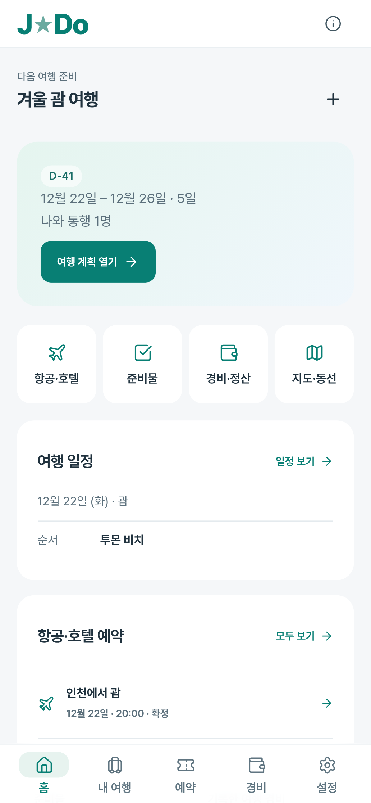
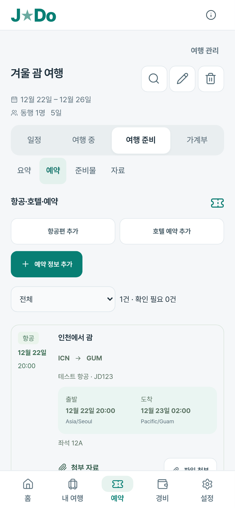
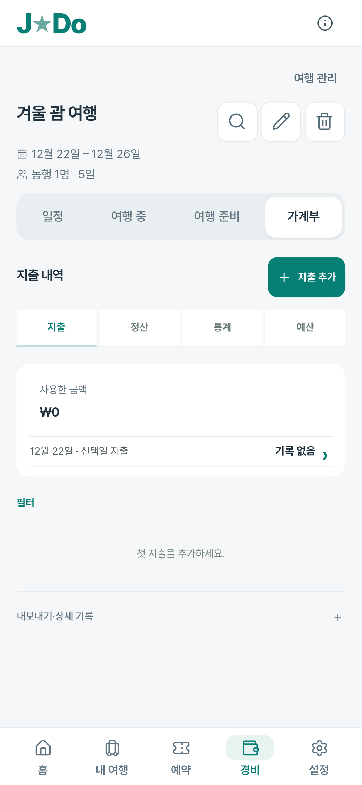
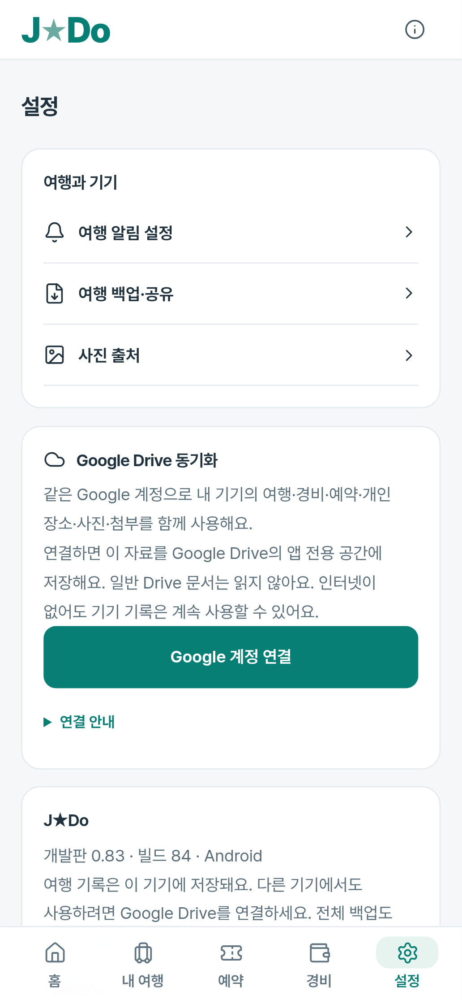

# J★Do 0.83 개인 여행 작업 개편

2026-11-11 사용자의 제품 구분 요청을 기준으로 가이드 기능을 제거하고 계획·현장 실행·항공/호텔 정보·경비·정산에 집중했다. [전체 변경과 호환 계약](../../../TRAVEL-WORKSPACE.md), [서명·공개 다운로드 검증](../../release-0.83-verification.json).

## 적용

- 가이드·공개 추천·블로그·코스·다운로드 화면과 자동 공개 정보 요청을 제거했다. GitHub 점검·검증의 schedule/push 트리거도 중지했다. 과거 공개 원본은 이전 개인 일정·사진·ID와 백업 호환용으로 보존한다.
- 도시·국가·날짜를 입력해 새 여행을 만들고 시간을 비운 일정부터 계획한다. 장소는 직접 입력·명시적 지도 검색·자신이 등록한 장소로 추가한다.
- 홈과 하단 메뉴를 개인 일정·예약·경비 작업 중심으로 재구성했다. 여러 여행의 예약/경비 작업은 여행을 명시적으로 고른다.
- 항공편의 공항·편명·출발/도착 현지 날짜·시각·시간대·좌석·수하물, 호텔의 체크인/체크아웃·연락처·객실·예약 확인서를 기록한다. 실시간 운항·예약 서비스로 표현하지 않는다.
- 정산·통계·예산을 경비 상단에 노출하고 기존 계산·환불·송금·첨부·비용 중복 방지·실패 복구를 유지했다.

## 확인

현재 제품 대상 PC·모바일200개와 서버7개가 통과했다. 최종 화면은320/393/1440px에서 다시 확인했다. 처음 실패한2건은 폐기된 직접추가 버튼 이름을 찾던 검사로, 현재 이름으로 수정 후 PC·모바일2건을 재통과했다. 재실행은 고유 검사 수에 중복 합산하지 않았다. 기존 가이드/과거 홈 화면 전용 검사는 역사적 소스로 남기고 현재 기본 검사 목록에서 제외했다. 테스트 목록은 playwright.config.ts에 명시한다.

항공/호텔 상세와 빈 예약 시간의 전체ZIP·JSON·Drive 호환 버전, 날짜 변경선·공항 시간대, 동행자 전달의 예약 번호·연락처·좌석·개인 메모 제외를 검증했다. 기존 가이드 참조 DB85개/1,410곳과 다운로드64개도 읽기 검사를 통과했으며 신규 가이드를 만들지 않았다.

Google/Drive/Android 권한·파일 브리지는 통제된 응답으로 검사했다. 실제 Android 설치·기기별 키보드/TalkBack·실제 Google 로그인·휴대폰 두 대의 동기화·운항 변경 조회는 검증하지 않았다. 사진/가이드 참조 호환 자료는 남아 있어 APK에서 관련 바이트가 전부 제거된 것은 아니다. 새 키·iOS 작업은 하지 않았다.

## 현재 화면

합성 테스트 자료를 사용했다. 실제 개인 기록·예약 번호·사진은 사용하지 않았다.393px 화면에서 캡처한 동일 화면이며 기기 배율 때문에 PNG 픽셀 크기는 다르다.

| 홈 | 예약 | 경비 | 설정 |
| --- | --- | --- | --- |
|  |  |  |  |
