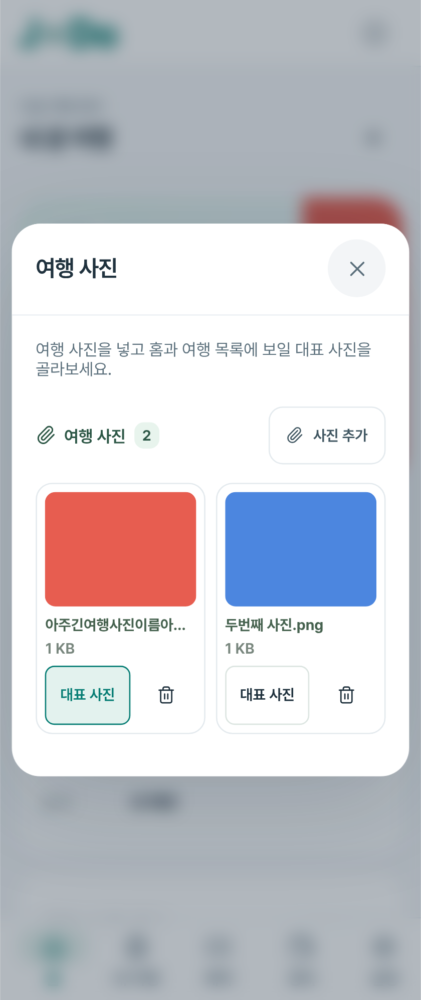
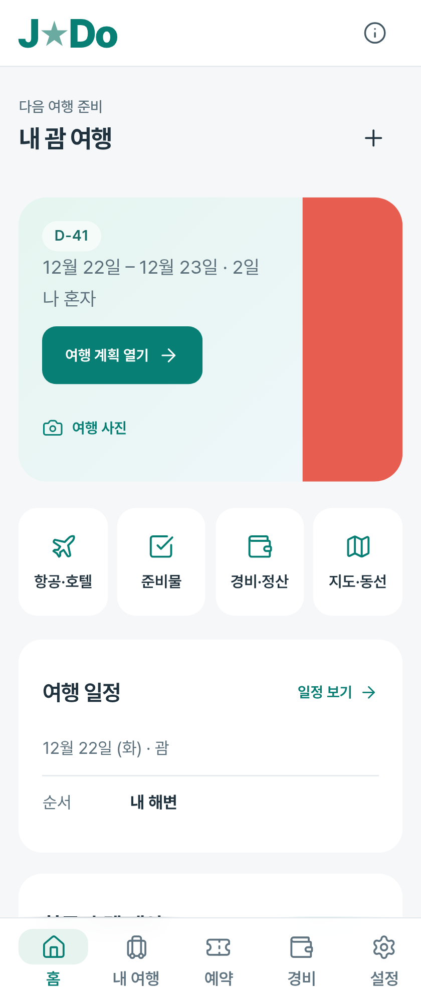

# J★Do 0.84 내 사진 확인

[사용·저장·보존 계약](../../../PERSONAL-TRAVEL-PHOTOS.md), [배포 검증](../../release-0.84-verification.json).

실제 사용자 파일은 읽거나 게시하지 않았다. 아래는 합성PNG 두 장으로 추가·대표 선택·320px 긴 파일 이름을 검증한 화면이다. 캡처의 빨강·파랑은 사진 불러오기 동작을 검증하기 위한 실제 생성PNG다.

| 사진 모음 ·320px | 홈 대표 사진 ·320px |
| --- | --- |
|  |  |

사진별 원본바이트·해시, 전체ZIP 파일 내보내기/복사본 복원·대표사진 연결, 기기별 여행 분리·재실행, 순서의 Drive 정규화/병합, 실패 시 기존자료 보존·미연결파일 정리, 취소·삭제·늦은 응답·미리보기 뒤로 처리를 확인한다. 기존 일정·예약·경비·알림·저장 안전성·Drive 검사도 유지한다. 최종 실제 결과는 배포 검증JSON에 기록한다.

첫 사진 검사 시도는 합성자료의 필수 링크/좌표 형식 오류로 실행 전 실패했으며 수정했다. 이후16개가 통과하고2개는 같은 날짜 여행 중 어떤 여행이 홈에 선택되는지에 대한 검사 전제와 달라 실패했다. 대상 여행의 서로 다른 날짜를 명시해 수정했다. 이 초기 결과나 재실행은 고유 통과 수에 중복 합산하지 않는다.

Android 사진 선택·뒤로 브리지와 Google/Drive는 모형/브라우저 이벤트 검증이다. 실제 휴대폰 설치·갤러리·기기별HEIC/HEIF 표시·실제Google 로그인·두 휴대폰 동기화는 미검증이다. 표시할 수 없는 사진은 저장 전에 거부하고 JPG/PNG로 선택하도록 안내한다. 새 서명키·iOS 작업은 하지 않았다.

최종 결과: 고유220개 통과. 전체218개와 최종 사진19개 통과, 빌드와 동시에 실행한 모바일 화면1건은30초 시간 초과 후 빌드 종료 뒤 변경 없이3.2초에 재통과했다. 재실행은 중복 합산하지 않았다. 실제Android 설치 검증으로 계산하지 않는다.
